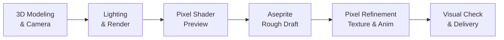

# Pixel Art

**English** | [简体中文](README.zh-CN.md)

Transform asset requirements into editable, exportable pixel art via **Blender MCP + Aseprite MCP**. Suitable for props and equipment, characters and creatures, scenes and architecture, UI decorations, and sprite animations.

The skill strings together style, palette, form, lighting, and pixel refinement into an end-to-end pipeline: check structures and visual effects first, then organize pixel clusters, materials, and animations, delivering native PNGs, sprite sheets, and editable Aseprite source files.

The default style is **Parchment Fantasy** (style ID: `parchment-fantasy`), but standalone custom styles can be expanded as needed.

## Pipeline

First define the subject, purpose, dimensions, and style. Blender establishes form and lighting baselines, while Aseprite handles pixel cleanup, detail refinement, and final exports.



Actual previews are shown and reviewed at each stage, with Shader results presented before entering rough draft pixel editing.

For portraits, the [design card](cards/portraits/design.md) selects the input route. When the user identifies an upload as model-generated or needs image generation, the selected 2D source passes through the [smooth portrait Pixel Shader](styles/parchment-fantasy/PORTRAIT-PIXEL-SHADER.md) before Aseprite. An existing suitable AI image needs no regeneration; eyes and expression are refined in Aseprite. Ordinary references do not automatically trigger an image-model call.

## Tips

1. Ensure **Blender MCP** and **Aseprite MCP** are installed and connected in the agent's environment.
2. This skill has substantial context. Ensure the agent has enough context capacity for its instructions and the current task.
3. One style, `parchment-fantasy`, is currently bundled. Extend the style library through the built-in [create-style](commands/create-style.md) interview, for example: `Using $pixel-art create-style, help me create a new style.`

## Showcase

<table>
  <tr>
    <td align="center" valign="middle"></td>
    <td align="center" valign="middle"></td>
    <td align="center" valign="middle"></td>
  </tr>
  <tr>
    <td align="center" valign="middle"></td>
    <td align="center" valign="middle"></td>
    <td align="center" valign="middle"></td>
  </tr>
</table>

## Usage

Prerequisites: Blender, Aseprite, Python 3.11+, Git, uv, and corresponding MCP services. Copy this folder into the target project's `.agents/skills/pixel-art/`, and run in the project root:

```bash
python3 .agents/skills/pixel-art/scripts/install_mcp.py
python3 .agents/skills/pixel-art/scripts/mcp_client.py doctor
```

The installer sets up Aseprite MCP pinned to a locked commit and configures the project. Blender MCP uses the registered service in the current environment; see [Blender MCP](mcp/blender.md) and [Aseprite MCP](mcp/aseprite.md) for setup details. If Aseprite is installed in a non-standard location, specify its executable via `ASEPRITE_PATH`.

Prompt an agent equipped with this skill, for example:

```text
Using $pixel-art, create a 64x64 fantasy leather potion pouch.
Use the parchment-fantasy style. First present the Blender model and Shader preview,
then refine pixels in Aseprite, delivering transparent PNGs and editable source files.
```

If invoking scripts directly from the skill repo, execute from the target project root and set the `PIXEL_PROJECT_ROOT` environment variable to the absolute path of the target project. Production artifacts and intermediate files are consolidated under that project's `Test Workspace/`.

## Skill Structure

[SKILL.md](SKILL.md) is the main skill entrypoint, handling style selection and taxonomy; [workflow.md](workflow.md) outlines phase-by-phase execution and review criteria.

| Directory | Contents |
|---|---|
| `cards/` | Modular injection templates for props, portraits, materials, and feature extensions |
| `styles/` | Common rules, style definitions, fixed palettes, and Pixel Shaders |
| `specs/` | Base specifications for common grid rules, lighting, textures, and delivery |
| `mcp/` | Blender and Aseprite integration guides, pinned version manifests |
| `scripts/` | MCP orchestration, diagnostics, and read-only technical verifications |
| `examples/` | Showcase assets with editable sources, sprite sheets, and frame metadata |
| `references/cases/` | In-house technical test cases, operational scopes, and limits |
| `asset-library/` | Cross-style source URLs, authors, license records, and on-demand usage |

## Reusable Base Assets

The [asset source index](asset-library/README.md) records UI, border, icon and texture sources across styles. Browse the [source websites](asset-library/INDEX.md), then download selected files into the project workspace only when needed, following the 50 MiB cache budget. The index stores metadata and license records; artwork and previews stay upstream. Most listed packs use CC0; Game-icons primarily uses CC BY 3.0 and requires applicable author attribution. See [third-party licenses](asset-library/THIRD_PARTY_LICENSES.md), and adapt working copies through Aseprite MCP.

Historical visual research for Parchment Fantasy referenced **Life in Adventure**; this skill has no official affiliation with the game or its copyright owners. The public distribution does not include screenshots, crops, extracted assets, or direct tracing studies from the game. See [NOTICE.md](NOTICE.md) for provenance and attribution.
