# Pixel Art

**English** | [简体中文](README.zh-CN.md)

Transform asset requirements into editable, exportable pixel art via **Blender MCP + Aseprite MCP**. Suitable for props and equipment, characters and creatures, scenes and architecture, UI decorations, and sprite animations.

The skill strings together style, palette, form, lighting, and pixel refinement into an end-to-end pipeline: check structures and visual effects first, then organize pixel clusters, materials, and animations, delivering native PNGs, sprite sheets, and editable Aseprite source files.

The default style is **Parchment Fantasy** (style ID: `parchment-fantasy`), but standalone custom styles can be expanded as needed.

## Pipeline

Two baselines, chosen by the agent per task ([Baseline Selection](specs/baselines.md)).

**Baseline A — Production.** First define the subject, purpose, dimensions, and style. The sole Blender route is pre-light structural Sobel → candidate/protection masks → actual lighting → protected SOFT.04 → palette quantization → constrained Aseprite source-color correction → refinement. See the [executable baseline](styles/parchment-fantasy/PIXEL-SHADER.md).

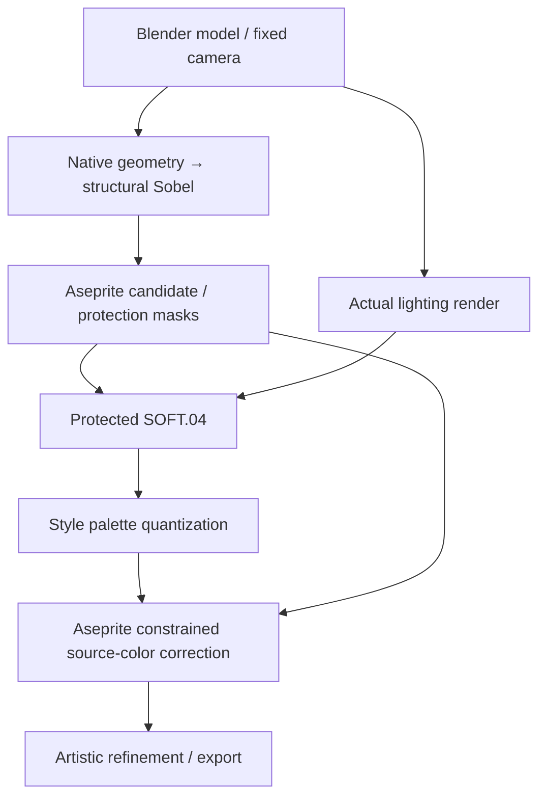

Actual previews are shown and reviewed at each stage, with Shader results presented before entering rough draft pixel editing.

**Baseline B — Agent Pure-Draw.** When the request is to reproduce a supplied 2D image rather than design a new subject, Aseprite alone redraws it at the reference's own pixel size — measured ground tone and silhouette, a median-cut working palette, then eight luminance bands drawn dark to light — and the result is verified against the original (SSIM / PSNR / tolerance coverage). See [cards/features/pure_draw.md](cards/features/pure_draw.md).

For portraits, the [design card](cards/portraits/design.md) selects the input route. When the user identifies an upload as model-generated or needs image generation, the selected 2D source passes through the [smooth portrait Pixel Shader](styles/parchment-fantasy/PORTRAIT-PIXEL-SHADER.md) before Aseprite. An existing suitable AI image needs no regeneration; eyes and expression are refined in Aseprite. Ordinary references do not automatically trigger an image-model call.

## Tips

1. Ensure **Blender MCP** and **Aseprite MCP** are installed and connected in the agent's environment.
2. This skill has substantial context. Ensure the agent has enough context capacity for its instructions and the current task.
3. One style, `parchment-fantasy`, is currently bundled. Extend the style library through the built-in [create-style](commands/create-style.md) interview, for example: `Using $pixel-art create-style, help me create a new style.`

## Prompt Examples

Five representative input modes, each shown as prompt → reference (if supplied) → result. The first three share one subject, so the prompt differences are limited to the reference clause (「按这个图」, follow this reference) and the image-model trigger (「用生图模型」, use an image-generation model); the full route comparison is in the [Portrait Generation Guide](docs/portrait-generation.md).

### 1. Prompt only — Baseline A, 3D pipeline

> 调用pixel-art，画骷髅的人物画像。
>
> *Using pixel-art, draw a skeleton portrait.*

No reference image. The request runs the full production pipeline — Blender geometry and physical lighting, the fixed style Pixel Shader, then Aseprite refinement. The jade spirit lights, forehead fracture and burgundy scarf are design additions made during production.


64×64 native, shown at 6×.

### 2. Prompt + reference image — Baseline A, 3D route

> 按这个图，调用pixel-art画骷髅的人物画像（参考图是全身图，但是人物画像不是，注意）
>
> *Following this image, use pixel-art to draw a skeleton portrait (the reference is a full-body image, but the portrait is not — note this).*

The supplied photograph is used as anatomy reference only; no image-generation model is called. The result keeps the reference's bare skull, eye sockets and tooth rows.

<table>
  <tr>
    <td align="center" valign="middle">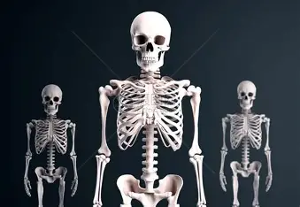<br><sub>Reference · 339×234</sub></td>
    <td align="center" valign="middle">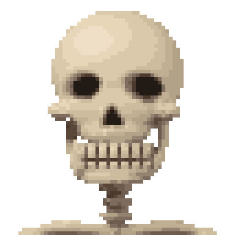<br><sub>Result · 64×64 native</sub></td>
  </tr>
</table>

### 3. Prompt + image-generation model — conditional 2D image-source route

> 按这个图，调用pixel-art并用生图模型画骷髅的人物画像（参考图是全身图，但是人物画像不是，注意）
>
> *Following this image, use pixel-art and an image-generation model to draw a skeleton portrait (the reference is a full-body image, but the portrait is not — note this).*

The explicit 「用生图模型」 trigger replaces 3D modeling and physical lighting with a generated 1254×1254 concept, which then passes through the smooth portrait Pixel Shader before Aseprite.

<table>
  <tr>
    <td align="center" valign="middle"><br><sub>Reference</sub></td>
    <td align="center" valign="middle">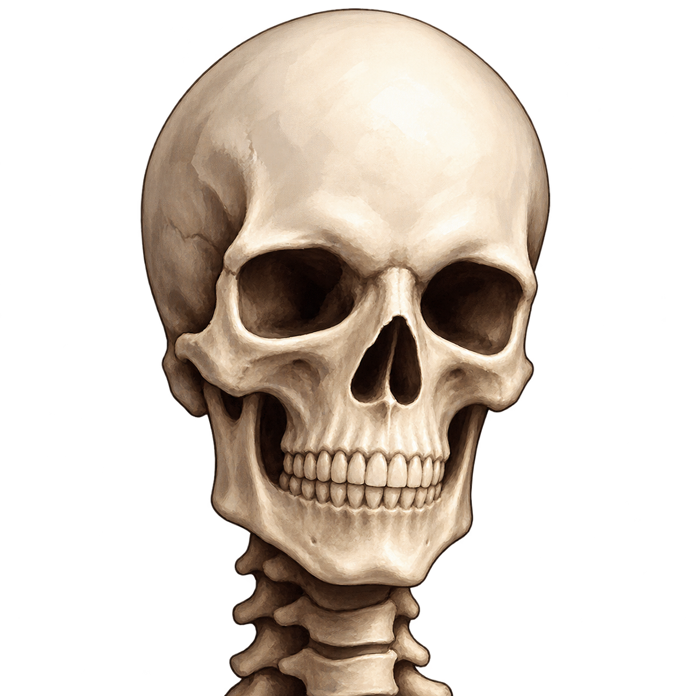<br><sub>Generated concept · 1254×1254</sub></td>
    <td align="center" valign="middle">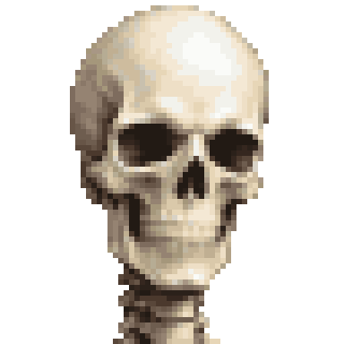<br><sub>Result · 64×64 Shader base</sub></td>
  </tr>
</table>

This comparison stops at the Phase 3 Shader pixel base; Aseprite refinement was not requested for it.

### 4. Prompt only, Baseline B requested — Aseprite 2D direct draw

> 使用基线2画一个Fantasy风格的ui背景，类似于一张向下逐渐破碎的纸张
>
> *Use Baseline 2 to draw a fantasy-style UI background, like a sheet of paper gradually shattering downward.*

Baseline B reproduces a supplied 2D image and requires a reference; none was supplied here. The skill therefore routes to the [Flat UI / 2D-direct-draw strategy](cards/features/flat_ui.md): Aseprite only, with the 3D, lighting and Pixel Shader phases skipped. 180×320 native, 15 colors, four layers; technical self-check passed, user review pending.

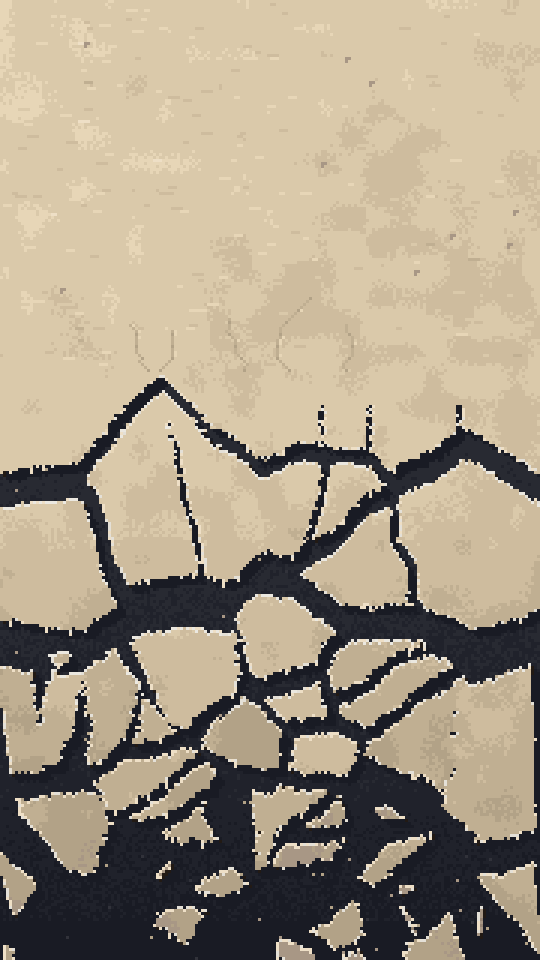

### 5. Prompt + reference image, Baseline B — Agent Pure-Draw

> 在不调用 pixel-art 下，请尝试用 aseprite 纯画这张图，要求按一定的步骤画，并保证 99 相似
>
> *Without calling pixel-art, try to draw this image purely in Aseprite, following a fixed step order and keeping ~99% similarity.*

Aseprite alone redraws the 260×75 reference at its own pixel size: 256-color median-cut palette, eight luminance bands, 14 drawing steps. The result is measured against the original. This run is the Baseline B calibration case; its numbers set the fidelity expectation for pure-draw reproductions.

<table>
  <tr>
    <td align="center" valign="middle"><br><sub>Reference · 260×75</sub></td>
    <td align="center" valign="middle">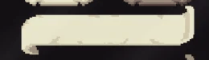<br><sub>Result · 260×75</sub></td>
  </tr>
</table>

**SSIM 0.999615 · PSNR 48.90 dB · 99.70% of pixels within 8/255 per channel · 97.83% within 4/255.** Bit-identical pixels are 77.88%: a redraw cannot reach 100% because the reference itself carries resampling noise. See the [pure-draw card](cards/features/pure_draw.md) and the [Baseline Selection guide](specs/baselines.md).

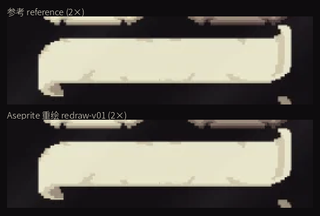

Reference above, pure-draw result below, both at 2× — visually indistinguishable at display scale.

## Showcase

### Buildings

Vegetation and environmental structures are grouped as buildings in this showcase. These previews and native PNGs retain transparency.

<table>
  <tr>
    <th>Shrub</th>
    <th>Birch Tree</th>
    <th>Ancient Marble Fountain</th>
  </tr>
  <tr>
    <td align="center" valign="middle"><a href="references/cases/shrub/case.md">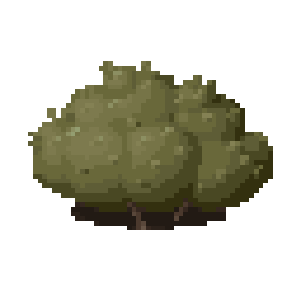</a></td>
    <td align="center" valign="middle"><a href="references/cases/birch-tree/case.md">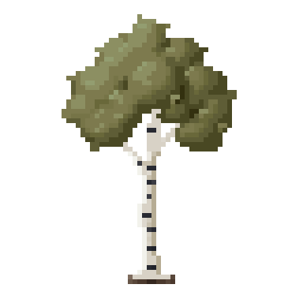</a></td>
    <td align="center" valign="middle"><a href="references/cases/ancient-marble-fountain/case.md">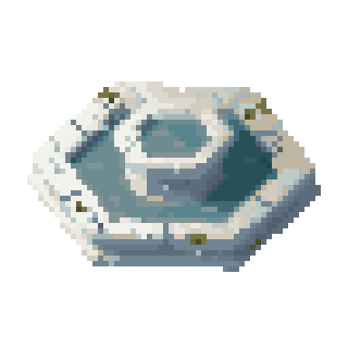</a></td>
  </tr>
</table>

- [Shrub](references/cases/shrub/case.md): 64×64 olive foliage with visible stems and separate leaf details.
- [Birch Tree](references/cases/birch-tree/case.md): 64×64 white bark, dark horizontal scars and a loose crown.
- [Ancient Marble Fountain](references/cases/ancient-marble-fountain/case.md): 64×64 hexagonal outer basin and raised central basin, with recessed water surfaces, marble veins and weathered masonry.

### Items

<table>
  <tr>
    <td align="center" valign="middle"></td>
    <td align="center" valign="middle"></td>
    <td align="center" valign="middle"></td>
  </tr>
  <tr>
    <td align="center" valign="middle"></td>
    <td align="center" valign="middle"></td>
    <td align="center" valign="middle"></td>
  </tr>
  <tr>
    <td align="center" valign="middle"><a href="references/cases/flame-sword/case.md">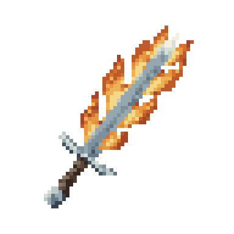</a></td>
    <td align="center" valign="middle"><a href="references/cases/bear-trap/case.md">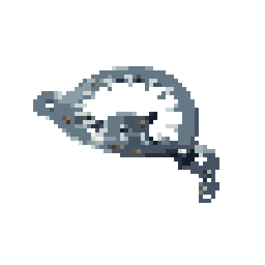</a></td>
    <td></td>
  </tr>
</table>

- [Flame Sword](references/cases/flame-sword/case.md): Accepted 64×64 transparent item, made through Blender, the fixed Pixel Shader, and Aseprite refinement; includes layered source and inventory-background previews.
- [Bear Trap](references/cases/bear-trap/case.md): 64×64 open iron jaws, a central pressure pan, springs and a short chain; includes transparent PNG and layered source.

### Portrait Cases

<table>
  <tr>
    <td align="center" valign="middle"></td>
    <td align="center" valign="middle"></td>
    <td align="center" valign="middle"></td>
  </tr>
  <tr>
    <td align="center" valign="middle"></td>
    <td align="center" valign="middle"></td>
    <td align="center" valign="middle"><a href="references/cases/armored-spider/case.md">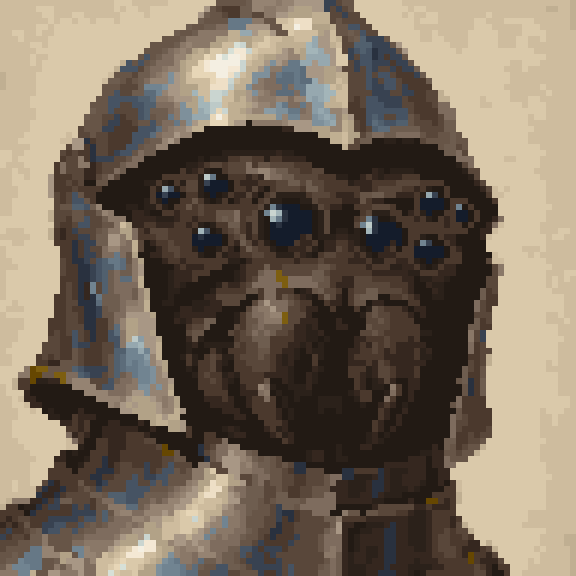</a></td>
  </tr>
</table>

- [Armored Spider Portrait](references/cases/armored-spider/case.md): Accepted 96×96 image-source portrait, refined through the smooth Shader and Aseprite, with editable source and before/after comparison.
- [Portrait Generation Guide & Three Baselines Comparison](docs/portrait-generation.md): Detailed explanation of portrait composition specifications, 3D vs 2D image-source pipeline branching, and comparison of three skeleton portrait baselines.

## Usage

Prerequisites: Blender, Aseprite, Python 3.11+, Git, uv, and corresponding MCP services. Copy this folder into the target project's `.agents/skills/pixel-art/`, and run in the project root:

```bash
python3 .agents/skills/pixel-art/scripts/install_mcp.py
python3 .agents/skills/pixel-art/scripts/mcp_client.py doctor
```

The installer sets up Aseprite MCP pinned to a locked commit and configures the project. Blender MCP uses the registered service in the current environment; see [Blender MCP](mcp/blender.md) and [Aseprite MCP](mcp/aseprite.md) for setup details. If Aseprite is installed in a non-standard location, specify its executable via `ASEPRITE_PATH`.

Prompt an agent equipped with this skill, for example:

```text
Using $pixel-art, create a 64x64 fantasy leather potion pouch.
Use the parchment-fantasy style. First present the Blender model and Shader preview,
then refine pixels in Aseprite, delivering transparent PNGs and editable source files.
```

If invoking scripts directly from the skill repo, execute from the target project root and set the `PIXEL_PROJECT_ROOT` environment variable to the absolute path of the target project. Production artifacts and intermediate files are consolidated under that project's `Test Workspace/`.

## Skill Structure

[SKILL.md](SKILL.md) is the main skill entrypoint, handling style selection and taxonomy; [workflow.md](workflow.md) outlines phase-by-phase execution and review criteria.

| Directory | Contents |
|---|---|
| `cards/` | Modular injection templates for props, portraits, materials, and feature extensions |
| `styles/` | Common rules, style definitions, fixed palettes, and Pixel Shaders |
| `specs/` | Base specifications for common grid rules, lighting, textures, and delivery |
| `mcp/` | Blender and Aseprite integration guides, pinned version manifests |
| `scripts/` | MCP orchestration, diagnostics, and read-only technical verifications |
| `examples/` | Showcase assets with editable sources, sprite sheets, and frame metadata |
| `references/cases/` | In-house technical test cases, operational scopes, and limits |
| `asset-library/` | Cross-style source URLs, authors, license records, and on-demand usage |

## Reusable Base Assets

The [asset source index](asset-library/README.md) records UI, border, icon and texture sources across styles. Browse the [source websites](asset-library/INDEX.md), then download selected files into the project workspace only when needed, following the 50 MiB cache budget. The index stores metadata and license records; artwork and previews stay upstream. Most listed packs use CC0; Game-icons primarily uses CC BY 3.0 and requires applicable author attribution. See [third-party licenses](asset-library/THIRD_PARTY_LICENSES.md), and adapt working copies through Aseprite MCP.

Historical visual research for Parchment Fantasy referenced **Life in Adventure**; this skill has no official affiliation with the game or its copyright owners. The public distribution does not include screenshots, crops, extracted assets, or direct tracing studies from the game. See [NOTICE.md](NOTICE.md) for provenance and attribution.
