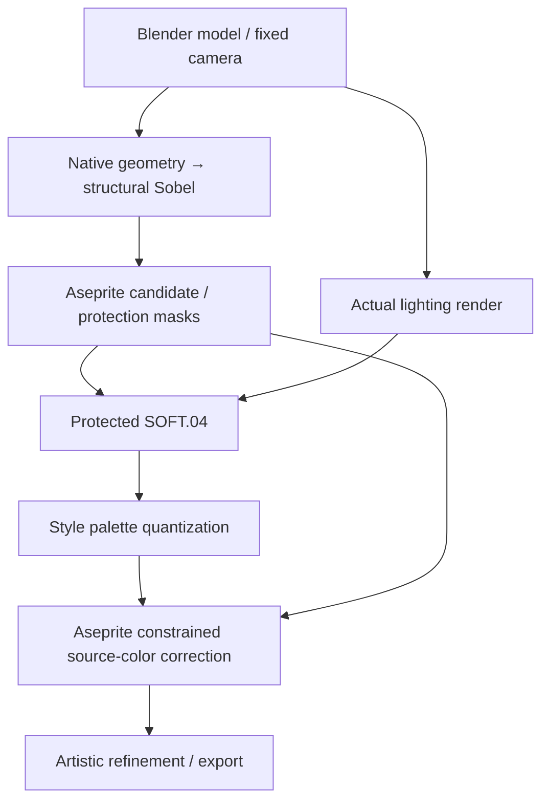

# Pixel Art

[English](README.md) | **简体中文**

通过 **Blender MCP + Aseprite MCP**，将素材需求转化为可编辑、可导出的像素美术。适用于道具与装备、角色与生物、场景与建筑、界面装饰及精灵动画。

技能将风格、配色、形体、光照和像素精修串成完整流程：先检查结构与视觉效果，再整理像素簇、材质和动画，最终交付原生 PNG、动画图集及可编辑的 Aseprite 源稿。

默认风格为 **羊皮纸奇幻（Parchment Fantasy）**，风格 ID 为 `parchment-fantasy`，也可按任务扩展独立风格。

## 制作流程

技能有**两条基线**，由 Agent 按任务选择（见[基线选择](specs/baselines.md)）。

**基线 A：制作基线**。先确定对象、用途、尺寸和风格。Blender 提供形体与光照依据，Aseprite 完成像素整理、细化和正式导出。

Blender 唯一基线：光照前结构 Sobel → 修改/保护掩码 → 实际光照 → 受保护 SOFT.04 → 色板量化 → Aseprite 受约束源色修正 → 精修。[执行入口](styles/parchment-fantasy/PIXEL-SHADER.md)。



各阶段展示实际预览并记录评审，Shader 效果在进入像素粗稿前展示。

**基线 B：Agent 纯画基线**。当需求是复刻一张已有的二维图（截图、现成美术、界面元素）而不是设计新对象时，只用 Aseprite 在参考图自身的像素尺寸上重画：量出主色与剪影、用 median cut 定工作调色板、按亮度切 8 档由暗到亮逐层落笔，最后对照原图做量化验收（SSIM / PSNR / 容差覆盖率）。见 [cards/features/pure_draw.md](cards/features/pure_draw.md)。

人物画像先由[设计卡](cards/portraits/design.md)选择输入路线。用户明确说明上传图来自生图模型，或需要生图时，选定的二维图先经过[平滑人物 Pixel Shader](styles/parchment-fantasy/PORTRAIT-PIXEL-SHADER.md)，再进入 Aseprite 精修眼睛和表情。已有 AI 图够用时无需重新生成，普通参考图不自动触发生图模型调用。

## Tips

1. 请确保 Agent 环境已安装并接入 **Blender MCP** 和 **Aseprite MCP**。
2. 该技能的上下文较长，请确保 Agent 有足够的上下文容量来承载技能说明及当前任务。
3. 当前内置一种风格 `parchment-fantasy`。可调用技能内置的 [create-style](commands/create-style.md)，通过问答扩展独立风格，例如：`使用 $pixel-art create-style，帮我创建一个新风格。`

## 提示词示例

5 种代表性输入方式，每个示例按「提示词 → 参考图（如有）→ 结果图」展示。前三个为同一题材，提示词差异只在参考图说明与生图触发词（「按这个图」/「用生图模型」）；完整路线对比见[人物画像生成说明](docs/portrait-generation.md)。

### （1）仅提示词 — 基线 A（3D 生产流程）

> 调用pixel-art，画骷髅的人物画像。

无参考图。请求按完整制作流程执行：Blender 几何与物理光照、固定风格 Pixel Shader，再到 Aseprite 精修。幽绿灵魂火、额头裂痕和酒红围巾为制作时的设计补充。


64×64 原生，6× 最近邻预览。

### （2）提示词 + 参考图 — 基线 A（3D 解剖还原）

> 按这个图，调用pixel-art画骷髅的人物画像（参考图是全身图，但是人物画像不是，注意）

参考图仅用于提取头颈解剖，不触发生图模型；结果保留参考图的裸颅骨、眼眶与牙列结构。

<table>
  <tr>
    <td align="center" valign="middle"><br><sub>参考图 · 339×234</sub></td>
    <td align="center" valign="middle"><br><sub>结果 · 64×64 原生</sub></td>
  </tr>
</table>

### （3）提示词 + 要求生图模型 — 条件 2D 生图管线

> 按这个图，调用pixel-art并用生图模型画骷髅的人物画像（参考图是全身图，但是人物画像不是，注意）

显式命中「用生图模型」触发词后，3D 建模与物理光照被 1254×1254 生图概念图取代，再经平滑人物 Pixel Shader 进入 Aseprite。

<table>
  <tr>
    <td align="center" valign="middle"><br><sub>参考图</sub></td>
    <td align="center" valign="middle"><br><sub>生图概念图 · 1254×1254</sub></td>
    <td align="center" valign="middle"><br><sub>结果 · 64×64 Shader 底稿</sub></td>
  </tr>
</table>

本案例完成到 Phase 3 Shader 像素底稿，未继续做 Aseprite 精修。

### （4）提示词 + 无参考图 + 要求基线 2 — Aseprite 2D 直绘

> 使用基线2画一个Fantasy风格的ui背景，类似于一张向下逐渐破碎的纸张

基线 B 的定义是复刻用户提供的二维参考图，本轮没有参考图，因此按 [Flat UI / 2D 直绘](cards/features/flat_ui.md)分流执行：只用 Aseprite，跳过 Blender、光照与 Pixel Shader 三个阶段。180×320 原生、15 色、4 图层；技术自检通过，用户评审待定。


### （5）提示词 + 参考图 + 要求基线 2 — Agent 纯画

> 在不调用 pixel-art 下，请尝试用 aseprite 纯画这张图，要求按一定的步骤画，并保证 99 相似

只用 Aseprite 在参考图自身的 260×75 尺寸上重画：256 色 median cut 工作调色板、8 个明度档、14 个落笔步骤，最后对照原图做量化验收。该案例是基线 B 的标定案例，其数值作为纯画复刻的预期基准。

<table>
  <tr>
    <td align="center" valign="middle"><br><sub>参考图 · 260×75</sub></td>
    <td align="center" valign="middle"><br><sub>结果 · 260×75</sub></td>
  </tr>
</table>

**SSIM 0.999615 · PSNR 48.90 dB · 99.70% 像素逐通道误差 ≤ 8/255 · 97.83% ≤ 4/255。** 逐像素完全相同 77.88%——参考图本身带重采样噪声，重画不可能做到 100%。详见[纯画基线卡](cards/features/pure_draw.md)与[基线选择规范](specs/baselines.md)。


上为参考图、下为纯画结果，均为 2× 显示：显示尺度下已难以分辨。

## 案例

### 建筑

本案例集将树木、灌木等环境植被与遗迹平台统一归入建筑。下列预览与原生 PNG 均保留透明背景。

<table>
  <tr>
    <th>灌木丛</th>
    <th>桦树</th>
    <th>远古大理石遗迹平台</th>
  </tr>
  <tr>
    <td align="center" valign="middle"><a href="references/cases/shrub/case.md"></a></td>
    <td align="center" valign="middle"><a href="references/cases/birch-tree/case.md"></a></td>
    <td align="center" valign="middle"><a href="references/cases/ancient-marble-fountain/case.md"></a></td>
  </tr>
</table>

- [灌木丛](references/cases/shrub/case.md)：64×64 灰橄榄绿叶团，保留短枝干和独立叶片细节层。
- [桦树](references/cases/birch-tree/case.md)：64×64 白色树皮、深色横纹和疏密叶冠。
- [远古大理石遗迹平台](references/cases/ancient-marble-fountain/case.md)：64×64 六边外池与中央高台，双层浅凹蓄水面，带大理石纹和风化石块拼缝。

### 物品

<table>
  <tr>
    <td align="center" valign="middle"></td>
    <td align="center" valign="middle"></td>
    <td align="center" valign="middle"></td>
  </tr>
  <tr>
    <td align="center" valign="middle"></td>
    <td align="center" valign="middle"></td>
    <td align="center" valign="middle"></td>
  </tr>
  <tr>
    <td align="center" valign="middle"><a href="references/cases/flame-sword/case.md"></a></td>
    <td align="center" valign="middle"><a href="references/cases/bear-trap/case.md"></a></td>
    <td></td>
  </tr>
</table>

- [火焰长剑](references/cases/flame-sword/case.md)：已验收的 64×64 透明物品，经 Blender、固定像素 Shader 与 Aseprite 精修，附分层源稿与物品栏背景预览。
- [捕兽夹](references/cases/bear-trap/case.md)：64×64 张开铁夹，包含锯齿、中央踏板、弹簧和短链，附透明 PNG 与分层源稿。

### 人物画像案例

<table>
  <tr>
    <td align="center" valign="middle"></td>
    <td align="center" valign="middle"></td>
    <td align="center" valign="middle"></td>
  </tr>
  <tr>
    <td align="center" valign="middle"></td>
    <td align="center" valign="middle"></td>
    <td align="center" valign="middle"><a href="references/cases/armored-spider/case.md"></a></td>
  </tr>
</table>

- [盔甲蜘蛛人物画像](references/cases/armored-spider/case.md)：已验收的 96×96 生图来源画像，经平滑 Shader 与 Aseprite 精修，附可编辑源稿和精修前后对比。
- [人物画像生成说明与三次骷髅基线对比](docs/portrait-generation.md)：人物画像特写构图、3D 与 2D 生图双分支决策，以及三次骷髅画像基线对比深度指南。

## 使用

准备可用的 Blender、Aseprite、Python 3.11+、Git、uv，以及相应 MCP 服务。将本文件夹复制到目标项目的 `.agents/skills/pixel-art/`，在项目根目录执行：

```bash
python3 .agents/skills/pixel-art/scripts/install_mcp.py
python3 .agents/skills/pixel-art/scripts/mcp_client.py doctor
```

安装器按固定版本安装 Aseprite MCP 并写入项目配置。Blender MCP 使用当前环境已注册的服务；详细接入方式见 [Blender MCP](mcp/blender.md) 与 [Aseprite MCP](mcp/aseprite.md)。Aseprite 安装在其他位置时，通过 `ASEPRITE_PATH` 指定可执行文件。

向支持该技能的 Agent 提出需求，例如：

```text
使用 $pixel-art，制作一个 64×64 的奇幻皮革药剂包。
采用 parchment-fantasy 风格，先展示 Blender 模型和 Shader 效果，
再进行像素精修，交付透明 PNG 和可编辑源稿。
```

若直接从技能仓库调用脚本，在目标项目根执行，并将 `PIXEL_PROJECT_ROOT` 环境变量设为目标项目的绝对路径。制作产物和临时文件统一保存在该项目的 `Test Workspace/`。

## 技能说明

[SKILL.md](SKILL.md) 是技能入口，负责风格与分类的选择；[workflow.md](workflow.md) 说明各阶段的执行与评审方式。

| 目录 | 内容 |
|---|---|
| `cards/` | 物品、人物画像、通用物理材质及特性扩展的模块化注入模板 |
| `styles/` | 通用规则、风格定义、固定色板与 Pixel Shader |
| `specs/` | 点阵基础规范、光照、纹理及交付规范 |
| `mcp/` | Blender 与 Aseprite 接入说明、固定版本清单 |
| `scripts/` | MCP 调用编排、诊断与只读技术检查 |
| `examples/` | 展示素材及其可编辑源稿、图集和帧数据 |
| `references/cases/` | 自制技术案例、适用范围与限制 |
| `asset-library/` | 跨风格素材来源网址、作者、协议记录与按需取用说明 |

## 通用基础素材

[素材来源索引](asset-library/README.zh-CN.md)只保存跨风格的来源网址、作者、协议和校验信息。先在[作者网站](asset-library/INDEX.md)浏览预览，需要时才下载选中的文件到项目工作区，遵守 50 MiB 缓存预算。多数来源为 CC0；Game-icons 以 CC BY 3.0 为主，使用时保留对应作者署名，详见[第三方协议说明](asset-library/THIRD_PARTY_LICENSES.md)。选中的工作副本通过 Aseprite MCP 改造为目标风格。

羊皮纸奇幻的历史视觉研究参考过 **Life in Adventure**，本技能与该游戏及其权利人无官方关联。公开包不附带该游戏的截图、裁切图、提取素材或临摹稿；来源与权属说明见 [NOTICE.md](NOTICE.md)。
