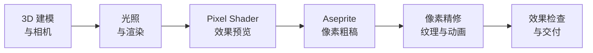
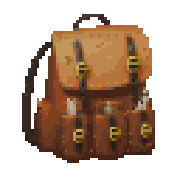
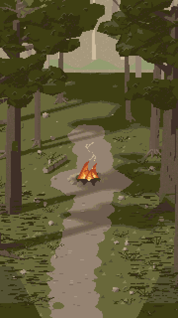
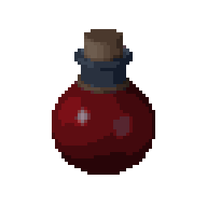
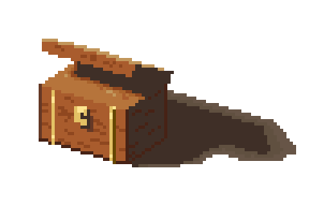

# Pixel Art

[English](README.md) | **简体中文**

通过 **Blender MCP + Aseprite MCP**，将素材需求转化为可编辑、可导出的像素美术。适用于道具与装备、角色与生物、场景与建筑、界面装饰及精灵动画。

技能将风格、配色、形体、光照和像素精修串成完整流程：先检查结构与视觉效果，再整理像素簇、材质和动画，最终交付原生 PNG、动画图集及可编辑的 Aseprite 源稿。

默认风格为 **羊皮纸奇幻（Parchment Fantasy）**，风格 ID 为 `parchment-fantasy`，也可按任务扩展独立风格。

## 制作流程

先确定对象、用途、尺寸和风格。Blender 提供形体与光照依据，Aseprite 完成像素整理、细化和正式导出。



各阶段展示实际预览并记录评审，Shader 效果在进入像素粗稿前展示。

人物画像先由[设计卡](cards/portraits/design.md)选择输入路线。用户明确说明上传图来自生图模型，或需要生图时，选定的二维图先经过[平滑人物 Pixel Shader](styles/parchment-fantasy/PORTRAIT-PIXEL-SHADER.md)，再进入 Aseprite 精修眼睛和表情。已有 AI 图够用时无需重新生成，普通参考图不自动触发生图模型调用。

## Tips

1. 请确保 Agent 环境已安装并接入 **Blender MCP** 和 **Aseprite MCP**。
2. 该技能的上下文较长，请确保 Agent 有足够的上下文容量来承载技能说明及当前任务。
3. 当前内置一种风格 `parchment-fantasy`。可调用技能内置的 [create-style](commands/create-style.md)，通过问答扩展独立风格，例如：`使用 $pixel-art create-style，帮我创建一个新风格。`

## 案例

<table>
  <tr>
    <td align="center" valign="middle"></td>
    <td align="center" valign="middle"></td>
    <td align="center" valign="middle"></td>
  </tr>
  <tr>
    <td align="center" valign="middle"></td>
    <td align="center" valign="middle"></td>
    <td align="center" valign="middle"></td>
  </tr>
</table>

## 使用

准备可用的 Blender、Aseprite、Python 3.11+、Git、uv，以及相应 MCP 服务。将本文件夹复制到目标项目的 `.agents/skills/pixel-art/`，在项目根目录执行：

```bash
python3 .agents/skills/pixel-art/scripts/install_mcp.py
python3 .agents/skills/pixel-art/scripts/mcp_client.py doctor
```

安装器按固定版本安装 Aseprite MCP 并写入项目配置。Blender MCP 使用当前环境已注册的服务；详细接入方式见 [Blender MCP](mcp/blender.md) 与 [Aseprite MCP](mcp/aseprite.md)。Aseprite 安装在其他位置时，通过 `ASEPRITE_PATH` 指定可执行文件。

向支持该技能的 Agent 提出需求，例如：

```text
使用 $pixel-art，制作一个 64×64 的奇幻皮革药剂包。
采用 parchment-fantasy 风格，先展示 Blender 模型和 Shader 效果，
再进行像素精修，交付透明 PNG 和可编辑源稿。
```

若直接从技能仓库调用脚本，在目标项目根执行，并将 `PIXEL_PROJECT_ROOT` 环境变量设为目标项目的绝对路径。制作产物和临时文件统一保存在该项目的 `Test Workspace/`。

## 技能说明

[SKILL.md](SKILL.md) 是技能入口，负责风格与分类的选择；[workflow.md](workflow.md) 说明各阶段的执行与评审方式。

| 目录 | 内容 |
|---|---|
| `cards/` | 物品、人物画像、通用物理材质及特性扩展的模块化注入模板 |
| `styles/` | 通用规则、风格定义、固定色板与 Pixel Shader |
| `specs/` | 点阵基础规范、光照、纹理及交付规范 |
| `mcp/` | Blender 与 Aseprite 接入说明、固定版本清单 |
| `scripts/` | MCP 调用编排、诊断与只读技术检查 |
| `examples/` | 展示素材及其可编辑源稿、图集和帧数据 |
| `references/cases/` | 自制技术案例、适用范围与限制 |
| `asset-library/` | 跨风格素材来源网址、作者、协议记录与按需取用说明 |

## 通用基础素材

[素材来源索引](asset-library/README.zh-CN.md)只保存跨风格的来源网址、作者、协议和校验信息。先在[作者网站](asset-library/INDEX.md)浏览预览，需要时才下载选中的文件到项目工作区，遵守 50 MiB 缓存预算。多数来源为 CC0；Game-icons 以 CC BY 3.0 为主，使用时保留对应作者署名，详见[第三方协议说明](asset-library/THIRD_PARTY_LICENSES.md)。选中的工作副本通过 Aseprite MCP 改造为目标风格。

羊皮纸奇幻的历史视觉研究参考过 **Life in Adventure**，本技能与该游戏及其权利人无官方关联。公开包不附带该游戏的截图、裁切图、提取素材或临摹稿；来源与权属说明见 [NOTICE.md](NOTICE.md)。
