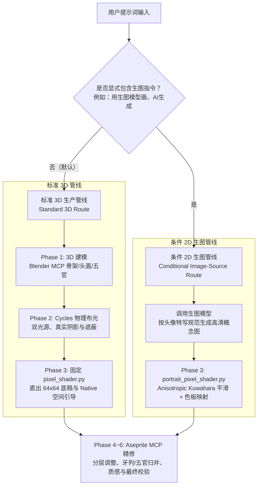

# 人物画像生成说明与三次骷髅基线对比

本文档归纳了项目在像素人物画像（Portrait）生成上的生产管线分支决策机制，并通过三次几乎相同提示词、不同基线触发方式的**骷髅人物画像**，简要说明在不同提示词下，经过的基线不同，从而产出的效果不同。

---

## 第一部分：生产管线双分支决策机制

人物画像根据用户提示词中的意图与特定关键词，严格分流为两条正交管线：

### 分支 A：标准 3D 生产管线（Standard 3D Route）
* **触发条件**：常规提示词、纯文字描述、或提供了普通参考图但**未包含生图关键词**。
* **执行过程**：
  1. **Phase 1 (3D)**：在 Blender MCP 中搭建头部/颅骨三维几何体（严禁单片面片），建立眼眶、鼻腔、下颌与颈部实体。
  2. **Phase 2 (Lighting)**：配置 Cycles 物理双光源（左上主光 + 弱补光），烘焙真实面部深度与遮挡阴影。
  3. **Phase 3 (Shader)**：执行标准 `pixel_shader.py`，输出 64×64 底稿与包含法线、距离、材质的原生射线引导（Native Ray Guidance）。
  4. **Phase 4~6 (Aseprite)**：依据空间引导在 Aseprite MCP 中对底稿进行分层精修、五官点睛与杂色归并。

### 分支 B：条件 2D 生图管线（Conditional Image-Source Route）
* **触发条件**：用户输入明确包含**生图触发指令**（如“用生图模型画”、“上传的图是生图模型”）。普通参考图绝不自动触发生图。
* **执行过程**：
  1. **概念生成**：撰写严格限定特写构图的提示词，生成透明底高清手绘概念图。
  2. **专属平滑 Shader**：跳过 3D 建模与物理布光（Q1/Q2），直接进入 Blender MCP 运行专属 `portrait_pixel_shader.py`。
  3. **各向异性平滑（Anisotropic Kuwahara）**：在工作网格进行方向性边缘保留平滑，消除 AI 图的细碎杂色与噪点，再经 Oklab 调色板量化映射至 64×64 原生底稿。
  4. **Phase 4~6 (Aseprite)**：导入 Aseprite MCP 进一步修整牙列、五官与轮廓。

---

## 第二部分：三次骷髅基线对比（提示词差异 → 基线分流 → 效果差异）

针对“骷髅的人物画像”这一核心需求，通过三次输入提示词的细微差异，说明经过的基线不同，从而效果不同：

### 1. 骷髅 1：纯文本 3D 标准管线

* **提示词**：`调用pixel-art，画骷髅的人物画像。`
* **触发的基线**：**标准 3D 生产管线**。无参考图且无生图关键词，在 Blender MCP 中从零构建 3D 颅骨几何与服饰实体，经 Cycles 物理双光源布光与固定 `pixel_shader.py` 直出带空间光照引导的原生底稿，并在 Aseprite 中完成全流程精修。
* **最终结果**：
  
  * **效果**：自主补充了角色延展设计（额头裂痕、缺损门牙、眼窝幽绿色灵魂火、底部酒红色残破围巾），3 色族（earth/ruby/jade，27 色），三维实体感强、角色辨识度高。

---

### 2. 骷髅 2：全身参考图 3D 解剖还原管线

* **提示词**：`按这个图，调用pixel-art画骷髅的人物画像（参考图是全身图，但是人物画像不是，注意）`（附带全身骨架摄影图）
* **触发的基线**：**基于参考图解剖的 3D 重构管线**。提供了全身参考图但**无生图关键词**，依然走 3D 生产管线。在 Blender MCP 中剥离所有非解剖饰物，严格按参考图提取头颈解剖并重构写实 3D 颅骨几何、牙列与下颌，经 Cycles 物理布光与固定 Shader 直出底稿后在 Aseprite 中精修。
* **最终结果**：
  | 用户参考图 | 最终 6× 放大成品 |
  | :---: | :---: |
  |  |  |
  * **效果**：纯写实人体骷髅解剖，无任何外加服饰与魔法眼光，严格收敛为单一 `earth` 色族（12 色阶），呈现干燥哑光的象牙骨质感与精准的骨骼光影。

---

### 3. 骷髅 3：参考图 + 显式生图 2D 管线

* **提示词**：`按这个图，调用pixel-art并用生图模型画骷髅的人物画像（参考图是全身图，但是人物画像不是，注意）`
* **触发的基线**：**条件 2D 生图平滑管线**。提示词显式命中了触发词「**用生图模型**」，规则允许跳过 3D 建模与物理布光。先调用生图模型生成 1254×1254 高清概念特写原画，再通过 Blender MCP 专属 `portrait_pixel_shader.py`（Anisotropic Kuwahara 方向性平滑滤波 + Oklab 映射）直出 64×64 原生底稿。
* **最终结果**：
  | 2D 高清概念原画 | Phase 3 像素化底稿 6× 预览 |
  | :---: | :---: |
  |  |  |
  * **效果**：手绘概念插画转像素风格，使用 `earth` + `paper` 两族色彩（28 色），面部明暗大体块过渡柔和细腻，消除了微观噪点，展现出独特的平滑手绘像素质感（当前处于完成 Phase 3 Shader 像素底稿阶段）。
