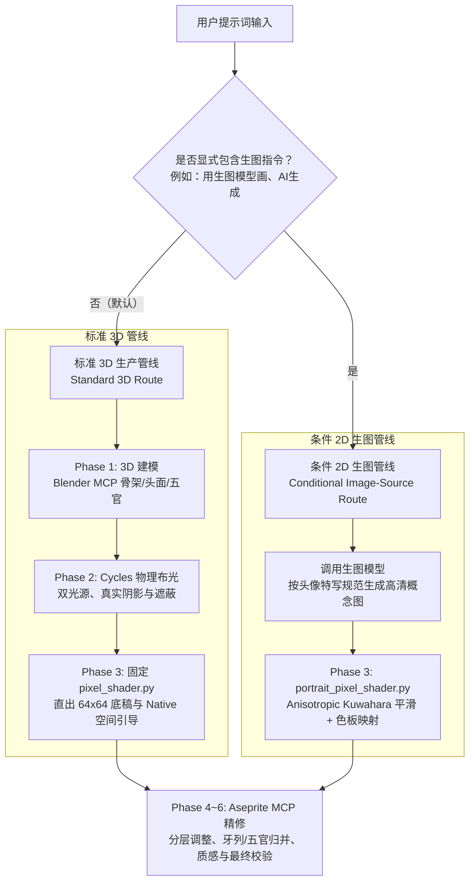

# 人物画像生成说明与三次骷髅基线对比

本文档归纳了项目在像素人物画像（Portrait）生成上的设计规范、生产管线分支决策与制作流程，并以三次几乎相同提示词、不同基线触发方式的**骷髅人物画像**为真实案例，进行提示词、参考图与产出结果的横向深度对比。

---

## 第一部分：人物画像生成规范与制作说明

### 1.1 核心取景与构图规范

在 64×64 等小尺寸原生像素画中，人物画像的核心任务是**清晰传达面部神态、五官特征与角色身份**。

* **特写构图（Head & Neck Close-up）**：
  * 头部与颈部必须占据画面主体面积（垂直占比通常在 75%～85%）。
  * 顶部边缘仅预留微量发顶/颅顶空间，让视觉重心完全聚焦于面部。
* **严格裁切肩胸与躯干**：
  * 底部仅保留极窄的衣领、锁骨或颈部衔接带。
  * 严禁出现胸部、手臂、完整肩线或半身像构图，防止衣服和背景过多挤占珍贵的像素预算，导致面部缩成难以辨识的小色块。
* **透明背景与多倍率导出**：
  * 画布为原生 64×64 RGBA（纯透明背景）。
  * 交付时提供原生尺寸与 6×（384×384）最近邻放大预览。

---

### 1.2 生产管线双分支决策机制

人物画像根据用户提示词中的意图与特定关键词，严格分流为两条正交管线：

#### 分支 A：标准 3D 生产管线（Standard 3D Route）
* **触发条件**：常规提示词、纯文字描述、或提供了普通参考图但**未包含生图关键词**。
* **执行过程**：
  1. **Phase 1 (3D)**：在 Blender MCP 中搭建头部/颅骨三维几何体（严禁单片面片），建立眼眶、鼻腔、下颌与颈部实体。
  2. **Phase 2 (Lighting)**：配置 Cycles 物理双光源（左上主光 + 弱补光），烘焙真实面部深度与遮挡阴影。
  3. **Phase 3 (Shader)**：执行标准 `pixel_shader.py`，输出 64×64 底稿与包含法线、距离、材质的原生射线引导（Native Ray Guidance）。
  4. **Phase 4~6 (Aseprite)**：依据空间引导在 Aseprite MCP 中对底稿进行分层精修、五官点睛与杂色归并。

#### 分支 B：条件 2D 生图管线（Conditional Image-Source Route）
* **触发条件**：用户输入明确包含**生图触发指令**（如“用生图模型画”、“上传的图是生图模型”）。普通参考图绝不自动触发生图。
* **执行过程**：
  1. **概念生成**：撰写严格限定特写构图的提示词，生成透明底高清手绘概念图。
  2. **专属平滑 Shader**：跳过 3D 建模与物理布光（Q1/Q2），直接进入 Blender MCP 运行专属 `portrait_pixel_shader.py`。
  3. **各向异性平滑（Anisotropic Kuwahara）**：在工作网格进行方向性边缘保留平滑，消除 AI 图的细碎杂色与噪点，再经 Oklab 调色板量化映射至 64×64 原生底稿。
  4. **Phase 4~6 (Aseprite)**：导入 Aseprite MCP 进一步修整牙列、五官与轮廓。

---

### 1.3 调色板与材质规范（Parchment Fantasy Palette 4.3）

* **色族上限控制**：人物画像限制最多使用 **5 个色族**（常规肖像建议 1～3 族）。
* **骨骼材质特性**：
  * 骨骼属于干燥、哑光的矿物微孔质感，不是皮肤，禁用金属高光或皮肤泛红晕染。
  * 主体色系：`earth`（浅象牙白、暗褐转折面、深褐黑眼窝空腔）。
  * 受光增益：可搭配 `paper` 族表现额头或颧骨的羊皮纸浅亮面。
  * 装饰与魔法：布料使用 `ruby`（红），灵魂火焰/眼光使用 `jade`（翡翠绿）。
* **像素团块与噪点控制**：
  * 避免单像素孤岛（Singletons）与多余锯齿（Jaggies）。
  * 亮暗面以 2～4 像素以上连贯有方向的团块（Clusters）呈现，保留开阔的视觉休息区。

---

## 第二部分：三次骷髅画像生成对比分析

在项目试验中，针对**“骷髅的人物画像”**这一核心母题，执行了三次提示词微小差异但管线完全不同的生成实验：

### 2.1 综合对比总览

| 维度 | 第 1 次：纯文本 3D 标准管线 | 第 2 次：全身参考图 3D 解剖还原 | 第 3 次：参考图 + 显式生图 2D 管线 |
| :--- | :--- | :--- | :--- |
| **工作区目录** | [`Test Workspace/skeleton-portrait/`](file:///home/lucious/Repo/My%20Adventure/Test%20Workspace/skeleton-portrait) | [`Test Workspace/skeleton-reference-portrait-20261017/`](file:///home/lucious/Repo/My%20Adventure/Test%20Workspace/skeleton-reference-portrait-20261017) | [`Test Workspace/skeleton-portrait-20261017/`](file:///home/lucious/Repo/My%20Adventure/Test%20Workspace/skeleton-portrait-20261017) |
| **用户原始提示词** | `调用pixel-art，画骷髅的人物画像。` | `按这个图，调用pixel-art画骷髅的人物画像（参考图是全身图，但是人物画像不是，注意）` | `按这个图，调用pixel-art并用生图模型画骷髅的人物画像（参考图是全身图，但是人物画像不是，注意）` |
| **输入参考媒介** | **无参考图**（纯文本指令） | **全身骨架摄影参考图**（提取中央骷髅解剖） | **全身骨架摄影参考图** + **生图模型 2D 概念原画** |
| **触发基线路线** | **标准 3D 几何与物理光照管线** | **解剖参考图引导的 3D 重构管线** | **条件触发 2D 生图来源平滑管线** |
| **Phase 1~2 实施** | Blender 3D 几何从零建模 + Cycles 物理布光 | 复用独立 3D 场景并重构解剖 + Cycles 物理布光 | 跳过 3D 建模；由 2D 概念图直接提供光影与结构 |
| **Phase 3 Shader** | `pixel_shader.py` 1.3.0（带 1514 条空间射线引导） | `pixel_shader.py` 1.3.0（带 1565 条空间射线引导） | `portrait_pixel_shader.py`（Anisotropic Kuwahara 平滑） |
| **调色板选用** | 3 族：`earth` + `ruby` + `jade`（共 27 色） | 1 族：仅使用 `earth`（共 12 色阶） | 2 族：`earth` + `paper`（共 28 色） |
| **最终视觉产物** | 原生 64×64 PNG、6× 放大 PNG、5 图层 Aseprite 源稿 | 原生 64×64 PNG、6× 放大 PNG、3 图层 Aseprite 源稿 | 原生 64×64 像素底稿、6× 放大预览、Blender 场景源稿 |
| **当前完成状态** | **Phase 6 最终成品交付**（完整走完 6 阶段） | **Phase 6 最终成品交付**（完整走完 6 阶段） | **Phase 3 Shader 像素底稿完成**（待审核进入 Aseprite） |

---

### 2.2 详细案例拆解

#### 案例 1：纯文本 3D 标准管线（自主设计发挥）

* **提示词背景**：用户仅给出了一句纯文本指令 `调用pixel-art，画骷髅的人物画像。`，未提供任何图片参考。
* **处理过程**：
  1. **自主设计延展**：由于无外部图像约束，设计卡补充了奇幻 RPG 冒险肖像元素：额头带有旧伤裂纹、单侧断齿、眼眶中注入幽微的碧玉色（jade）灵魂火，颈部围裹酒红色（ruby）残破围巾以强化构图稳定性。
  2. **3D 实体构建**：在 Blender MCP 中搭建 `SkeletonPortrait_v02` 独立场景，布尔开凿深邃眼窝与鼻腔，布置 8 颗上排牙与下颌。
  3. **物理布光与着色**：Cycles 600W 碟形主光 + 65W 辅光，经由固定 `pixel_shader.py` 获得扎实的受光面与阴影遮蔽。
  4. **Aseprite 精修**：将底稿导入 Aseprite，精细刻画额头骨裂（34 像素）、围巾折痕（28 像素）与不对称的灵魂眼光点。
* **结论与评价**：三维空间感极强，色彩丰富生动，兼具游戏角色的辨识度与故事感。

---

#### 案例 2：全身参考图 3D 解剖还原管线（严格解剖约束）

| 用户参考图 | 最终 6× 放大成品 |
| :---: | :---: |
|  |  |

* **提示词背景**：用户输入 `按这个图，调用pixel-art画骷髅的人物画像（参考图是全身图，但是人物画像不是，注意）` 并附带了摄影照片。虽然提供了图片，但**未声明使用生图模型**，因此必须严格走标准 3D 流程。
* **处理过程**：
  1. **构图与解剖提取**：精准遵循“参考图是全身图，人物画像不是”的要求，完全剥离参考图中的下肢、胸腔、背景杂质，仅截取颅骨与第一二颈椎，下方仅留最窄幅度的锁骨端头。
  2. **3D 几何解剖重构**：深度复制前序场景为独立工程，剥离所有衣物、裂纹与魔法眼光。重新调整下颌横向比例为 0.84，重塑梨状鼻孔，补全缺损牙列，使骨骼严丝合缝地吻合医学解剖结构。
  3. **色彩纯净化**：放弃 ruby 和 jade，调色板彻底收敛为单一的 `earth` 色族（仅使用 12 个明暗梯度），还原参考图中象牙质骨骼在自然受光下的哑光效果。
  4. **Aseprite 精修**：利用 1565 条空间表面引导数据，手工归纳牙缝、颧弓转折与眶缘暗部，消除杂色噪点。
* **结论与评价**：结构最写实、解剖最严谨的 3D 原生像素作品。证明了在有参考图但未授权生图时，3D 建模管线同样能精确还原参考图的解剖精髓。

---

#### 案例 3：参考图 + 显式生图触发词 2D 管线（手绘平滑下采样）

| 2D 高清概念原画 | Phase 3 像素化底稿 6× 预览 |
| :---: | :---: |
|  |  |

* **提示词背景**：用户提示词为 `按这个图，调用pixel-art并用生图模型画骷髅的人物画像（参考图是全身图，但是人物画像不是，注意）`。因命中触发词「**并用生图模型**」，管线严格切入 conditional image-source route。
* **处理过程**：
  1. **生图提示词编排**：依据肖像设计卡，提示词中显式强调特写构图、裁切四肢躯干、平滑大体块光影、剔除微小噪点裂纹。生成了 1254×1254 RGBA 高分辨率手绘概念原画 [`references/selected-portrait.png`](images/skeleton-v3-concept.png)。
  2. **专属平滑 Pixel Shader**：将概念图载入 Blender MCP，通过 `portrait_pixel_shader.py` 执行 Anisotropic Kuwahara（Size 4.0）边缘保留平滑与 Oklab 颜色映射。
  3. **调色板匹配**：骨骼亮部使用 `paper` 色族呈现羊皮纸光泽，转折面与深空腔使用 `earth` 色族，两族共映射出 28 色。
  4. **当前状态**：完成 Phase 3 Shader 像素底稿输出（[`shader-v01/pixel-base-v01.png`](file:///home/lucious/Repo/My%20Adventure/Test%20Workspace/skeleton-portrait-20261017/shader-v01/pixel-base-v01.png)），等待用户审核后进入 Aseprite 进行五官精修。
* **结论与评价**：展现了 2D 概念插画转像素画的独特风格，面部受光与阴影过渡柔和自然，大色块聚类效果优秀，大幅缩短了上游 3D 建模的周期。

---

## 第三部分：横向机理剖析与最佳实践总结

### 3.1 提示词触发边界的重要性

| 输入场景 | 关键词特征 | 正确走向 | 常见错误判定 |
| :--- | :--- | :--- | :--- |
| **纯文本** | 无图片，仅描述角色 | **标准 3D 管线**（Blender 建模 + Cycles 布光） | 错误：擅自调用生图模型绘制概念图 |
| **附带参考图** | 提供照片/立绘，但无生图词汇 | **标准 3D 管线**（以 3D 几何还原参考图解剖与结构） | 错误：看到图片带有 AI 感就擅自走生图分支 |
| **明确指定生图** | 包含“用生图模型”、“AI生成” | **条件 2D 生图管线**（生图 + Kuwahara 平滑 Shader） | 错误：依然花大量时间在 Blender 中建立 3D 模型 |

### 3.2 全身参考图的“取景降维”法则

当用户输入一张全身图并要求绘制“人物画像”时：
1. **绝对不可直接将全身图送入下采样 Shader**：否则人物在 64×64 中只有几个像素高，面部彻底失真崩溃。
2. **三维管线处理法**：在 3D 建模阶段主动裁剪，只建立头颈模型与微量锁骨/衣领，忽略参考图中的躯干四肢（见骷髅 2）。
3. **二维生图处理法**：在生图 Prompt 中强行注入特写约束（`tight head-and-neck composition, crop shoulders completely`），让生图模型重新构图出特写头像，再送入平滑 Shader（见骷髅 3）。

### 3.3 3D 空间引导与 2D 滤波平滑的互补价值

* **3D 几何管线优势**：拥有真实的法线向量与物理深度遮挡（Native Guidance），即便在极暗处也能精准分离下颌与颈部，结构扎实、硬朗，适合工业化、多角度复用与标准 RPG 像素资产。
* **2D 生图平滑管线优势**：借助高维生图模型的艺术手绘表现力，能在极短时间内探索复杂的神态、奇特生物或细腻柔和的光影渐变，经由 Anisotropic Kuwahara 平滑后能提供极其舒适的手绘像素底稿。
