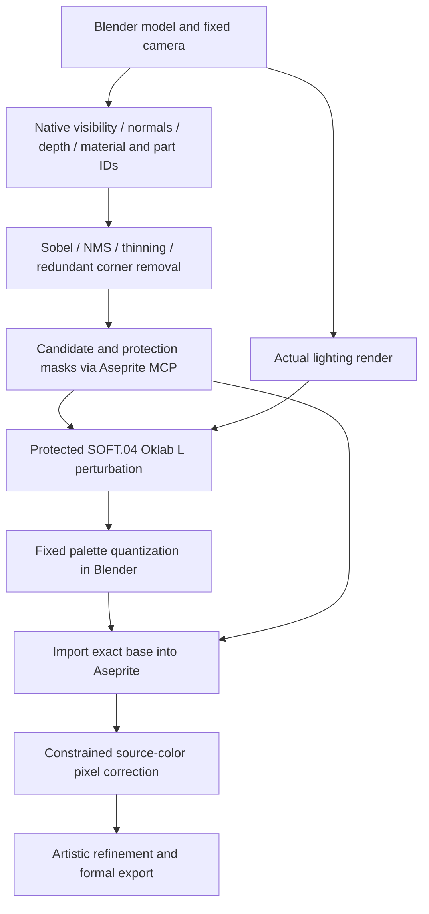

# Parchment Fantasy Structural Production Baseline

The sole Blender baseline is [pixel_shader.py](pixel_shader.py) **2.0.0**, Palette **4.3**. It implements the accepted structure-first workflow. There are no alternate Blender algorithms, guidance-free rendering entrypoints, or compatibility fallbacks. The independent 2D portrait route uses [palette_mapper.py](palette_mapper.py) without inventing geometry.



Execute geometry sampling and mask preparation **before** the lighting bake. The edge image only locates changes; normal-color output is retained. The default cleanup preserves alpha and does not modify the model. Lighting comes from the real render, not the normal/depth maps.

## 1. Sample structure through Blender MCP

Load the confirmed model and camera scene. Original materials, lights and geometry remain unchanged. Run the following through `execute_blender_code`, replacing paths and material names with actual scene values:

```python
from pathlib import Path
import bpy
shader = Path("<skill-root>/styles/parchment-fantasy/pixel_shader.py")
ns = {"__file__": str(shader), "__name__": "parchment_production"}
exec(compile(shader.read_text(), str(shader), "exec"), ns)
result = ns["sample_structure"](
    bpy.data.scenes["<confirmed-source-scene>"],
    output_dir="<project-root>/Test Workspace/<task-id>",
    size=(64, 64),
    families=["leather", "earth", "gold", "green"],
    material_families={
        "<actual-leather-material>": ["leather"],
        "<actual-strap-material>": ["earth"],
        "<actual-metal-material>": ["gold"],
        "<actual-cloth-material>": ["green"],
    },
    protected_materials=[],  # Optional additional landmark materials.
)
```

Declare allowed families for **every visible material**. Transparent materials need families that include their transmitted colors. Native pixel-center ray casts record first-hit object/material, geometric world normal, world position, and ray distance. These are geometric signals, not smooth shading normals or full transmission decompositions.

Outputs: `guidance/surface-guidance.json`, `material-mask-N.png`, and `prelight-manifest.json`. The manifest binds grid, camera/frame/evaluated geometry, material ownership, and source hashes. Use a new task/version directory; do not mix prior guidance with a changed camera or mesh.

## 2. Analyze structure; create mask through Aseprite MCP

From the project root, use Python with **numpy, scipy, Pillow** installed. The Aseprite server environment need not contain these analysis dependencies.

```bash
python3 .agents/skills/pixel-art/scripts/structural_edges.py prepare --task <task-id>
python3 .agents/skills/pixel-art/scripts/mcp_client.py run \
  "Test Workspace/<task-id>/reports/mask.job.json" --log-name <task-id>-mask.json
```

The analysis script emits arrays/JSON only. The job makes real `create_sprite → draw_pixels → export_png` calls, producing `source/dither-mask.aseprite` and native `guidance/dither-mask.png`. Black means no perturbation, white means the full 0.04 strength. Inspect the mask, geometry samples and `guidance/structure.json` before lighting.

Structural rules inherited from the accepted trial:

- Sobel 3×3 kernels divided by 8; alpha magnitude threshold 0.10, geometric normal magnitude 0.12, ray-distance gradient 0.08 world units. Background normals/depth are extended from nearest valid samples; their edges are limited to the alpha interior.
- Object/material IDs use adjacent-label inequality, never numeric ID gradients. Combine structural edges, apply NMS and Zhang–Suen thinning, then remove redundant right-angle corner pixels while retaining endpoints and junctions.
- The protection band is a 1px Chebyshev dilation of cleaned structure inside visible samples. Record its coverage; small assets with many parts can have broad coverage.
- Protect visible parts with ≤40 sampled pixels, gold-family materials, explicitly protected materials, and skeleton endpoints/junctions from source-color cleanup.

World-unit depth thresholds assume the confirmed asset scale; document scale changes and inspect candidates rather than silently reinterpreting thresholds. Zero safe candidates is a valid result.

## 3. Render protected SOFT.04 and palette through Blender MCP

Reload the same module as above, then invoke:

```python
result = ns["render_preview"](
    bpy.data.scenes["<confirmed-source-scene>"],
    output_dir="<project-root>/Test Workspace/<task-id>/shader",
    guidance_dir="<project-root>/Test Workspace/<task-id>/guidance",
    asset_type="prop_icon",
)
```

`guidance_dir` is mandatory. The renderer verifies the geometry signature, guidance hashes, native size and actual mask pixels before baking. It creates isolated lighting and pixel scenes. Outputs are:

- `shader/lighting-native.png`: 16-bit actual lighting, source AgX/Look/exposure baked once.
- `shader/pixel-base-v01.png`: native fixed-palette RGBA base.
- `shader/shader-preview.blend`: only the source, lighting and structural pixel scenes, with packed image inputs.
- `shader/shader-manifest.json`: implementation/palette/mapper hashes, actual inputs, guidance ownership, protection coverage, and output paths.

Blender compositor nodes compute `q = fract(rotate(normalized_pixel_center × (W,H), 0.785398))`, `p = 2 × max(abs(q.x−0.5), abs(q.y−0.5))`, and `L′ = clamp(L + (p−0.5) × 0.04 × mask, 0, 1)`. Oklab a/b are unchanged. The pattern is deterministic, with no mean correction. Within the protection band mask=0; elsewhere mask=1.

Palette selection uses `2×ΔL² + Δa² + Δb²` and the real material ownership masks. Filter=0.01, Pixelate Size=1, alpha>0.5, final Standard/None/exposure0/gamma1. No artificial brightening or extra source color transform is applied. The native dimensions remain WxH; presentation scaling happens through Aseprite.

Present the exact native Shader base and same-view lighting comparison before production import, recording Q3 under the normal review rules. On animations, rerun sampling, masks and the bake for each changed frame.

## 4. Constrained correction through Aseprite MCP

After reviewing the base:

```bash
python3 .agents/skills/pixel-art/scripts/structural_edges.py cleanup --task <task-id>
python3 .agents/skills/pixel-art/scripts/mcp_client.py run \
  "Test Workspace/<task-id>/reports/cleanup.job.json" --log-name <task-id>-cleanup.json
```

This emits `reports/cleanup.json` and a real import/edit/export job. The exact Shader PNG is preserved as a hidden, locked `base-ref`; visible `draft` receives the source-color corrections. Initial export: `exports/pixel.png`. Continue artistic refinement on editable layers, then formally re-export the completed asset.

Each replacement must use a neighboring source pixel on the **same object and material**, with normal dot≥0.90, ray-distance difference≤0.15 world units, baked RGB distance≤0.12, ≤2 allowed ramp steps, and ≥2 neighboring pixels supporting the new color. Preserve the original alpha. Skip ambiguous and protected candidates. Do not choose an unrestricted 8-neighbor dominant color or paint diagnostic edge colors into the asset.

Verify material-family ownership, alpha, landmarks, native/zoom/grayscale previews and the source layers. Global palette compliance alone cannot detect a valid palette color assigned to the wrong material. Record the ray/render alpha discrepancy separately; pixels without a ray assignment receive no structural cleanup.

## Validation case

The [structural backpack case](../../references/cases/structural-backpack/case.md) records the accepted flow. It is an algorithm/rough-draft check, not a replacement for subject-specific artistic refinement or future visual reviews.
